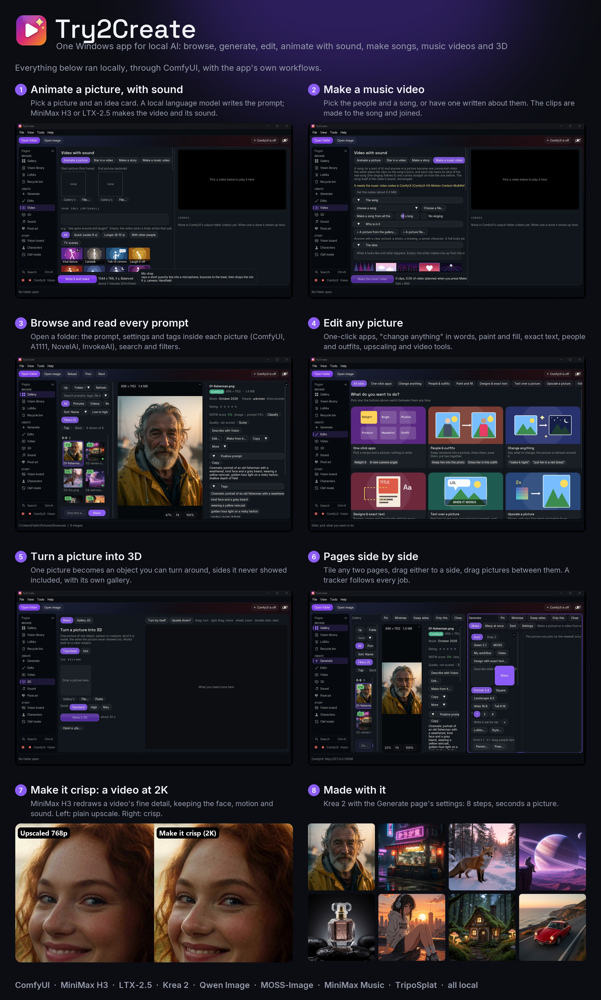

# Try2Create

A Windows app that puts a friendly face on local AI. You press a button; ComfyUI does the work behind it, so you never have to wire a
workflow. Pictures, edits, videos with sound, music, music videos, characters, 3D and pixel art, all running on your own GPU.



> **Status: early.** It grew as one person's app and most of it has only been run on one high-end PC. The setup is tested on a brand-new
> user profile, but expect rough edges on other hardware, and please open an issue when something doesn't work on yours.

## What it does

| | |
|---|---|
| **Gallery** | Open a folder and read the prompt, settings, LoRAs and tags inside every picture (ComfyUI, AUTOMATIC1111, NovelAI, InvokeAI...). Search by words or by meaning, filters, ratings, duplicate hiding, an NSFW blur. |
| **Generate** | One prompt box. It picks the model (Krea 2 for people and most pictures, Qwen Image for creatures and extreme looks, MOSS-Image for exact text), or runs your own ComfyUI workflow. LoRAs, styles, poses and many-at-once sit behind small chips. |
| **Edits** | One-click apps (relight, new angle, plushie, product shot...), "change anything" in words, paint and fill, designs with exact text and box edits, text layers (PhotoCraft), people and outfits, upscaling, and video tools. |
| **Video with sound** | Animate a picture with MiniMax H3 or LTX-2.5: idea cards, camera moves, and a local language model that writes the prompt. Long videos in parts, swapping a person into a clip, short stories, recreating a video, and *Make it crisp* to 2K. |
| **Sound** | Songs with lyrics (MiniMax Music), multi-voice audio scenes (Fish Audio Drama 3), and *Make a music video*: pick the people, a song (or have one written about them), and it makes the clips and joins them to the song. |
| **Characters & story** | Characters with backstories and sheets, a 360-degree turntable, a vision board, Clef mode (a scenario that keeps going picture after picture). |
| **3D** | One picture becomes a 3D object (a Gaussian splat) you can turn around, with its own gallery. |
| **Pixel art** | Pixel-art pictures made into real pixels. |
| **The workspace** | Pages tile side by side, drag a page to either side, drag pictures between pages, a job tracker in the status bar for everything running, and a Recycle bin page for what you delete. |

More screenshots are in [docs/screenshots](docs/screenshots).

## What you need

- Windows 10 or 11, 64-bit (the "N" editions need Microsoft's Media Feature Pack first)
- [ComfyUI](https://www.comfy.org/download): ComfyUI Desktop is found by itself; a portable ComfyUI, a git clone or one at another address is picked in the setup
- An NVIDIA GPU. Pictures and edits are fine on 12-16 GB; the video features want 24 GB.
- Plenty of RAM for video (ComfyUI holds big models in RAM: 64 GB or more for MiniMax H3)
- Disk space for the models. The setup downloads the packs you pick:

| Pack | For | Download |
|---|---|---|
| Pictures | Generate, Characters (Krea 2) | about 19 GB |
| Edits | Edits, creatures on Generate (Qwen Image 2.1) | about 17 GB |
| Designs | Exact text, posters, box edits (MOSS-Image) | about 13 GB |
| Video | Animate a picture, long videos (MiniMax H3) | about 42 GB |
| Music | Songs (MiniMax Music 3) | about 12 GB |
| 3D | The 3D page (TripoSplat) | about 4 GB |

Everything else is set up where you use it: a page says what's missing and has a *Set up* button that names the size first (person swap,
Make it crisp, Drama, LTX-2.5, faster video...). Models and node packs come from their publishers under their own licences; none are in
this repository, so check a model's licence before you use what it makes commercially.

Helpers, all optional and downloaded by the setup: ffmpeg (needed for anything that joins video), the prompt writer (a small local language
model; without it the app uses simple ready-made prompts) and PhotoCraft (text layers).

The small scoring models (NSFW by image, picture quality, people detection) aren't included either. `models/*.README.txt` says where each
comes from; without them the NSFW blur goes by the words in a picture's prompt, and everything else works.

A few models need you to accept their terms on Hugging Face first and be signed in on this PC: FLUX 3 Image Klein (Paint and fill; plain
edits use Qwen without it) and LTX-2.5. The page says which.

Two things stay a manual step: **Idol**, the better 3D option, needs its own Python install and access to two gated models, and the pose
and outfit picker reads your own copies of two galleries whose pictures can't be redistributed. The rest of the app doesn't need either.

## Getting started

1. Download `Try2Create.zip` from the latest [release](../../releases), unzip it anywhere you can write to (not Program Files) and run
   `Try2Create.exe`. Keep the folders next to the exe; they hold the fonts and the set-up scripts. Windows may warn about an unknown app, because the exe isn't signed.
2. **Set up Try2Create** opens by itself the first time. It looks at your graphics card and RAM and says what will run well; finds ComfyUI
   (or helps you install ComfyUI Desktop, or use a portable ComfyUI or one at another address); then offers the models as packs with their
   sizes, ticking only what fits your PC. Only ComfyUI is required: skip any pack or helper and add it later from *Help > Set up Try2Create*.
3. The Gallery works straight away: open a folder of AI pictures to read their prompts and settings.

Your settings, caches and crash reports stay in `%LOCALAPPDATA%\Try2Create`; there is no telemetry and no account. The app talks to your
ComfyUI and the sites a download comes from. Beyond that, the LoRA tools ask Civitai about a LoRA by its file hash (for its trigger words),
and the Vision board fetches a web address only when you paste one. If you're signed in to Hugging Face on this PC, that login is used only
for downloads from Hugging Face.

## Changing it with Claude Code (or any AI assistant)

The code is meant to be changed by asking. Clone the repo, open the folder in [Claude Code](https://claude.com/claude-code) and say what you
want: "add a one-click app that turns a photo into a sticker", "remove the Drama page", "make Generate default to square pictures".
[CLAUDE.md](CLAUDE.md) explains how the app is built, where each page lives, the conventions and how to test, so the assistant starts with
the full picture. Run `build.bat` to try the result.

## Building it

Install Visual Studio 2022 (or its Build Tools) with *Desktop development with C++*, then:

```bat
build.bat
```

`Try2Create.exe` lands next to the script, with the ONNX Runtime DLLs it needs. `package.bat` makes a zip to share. Every push to `main`
is also built by GitHub Actions (see *Actions* for the latest `Try2Create` zip).

## Contributing

Ideas, bug reports and pull requests are welcome. The parts that need the most help:

- **Smaller GPUs**: lighter model choices (GGUF, fp8) for 8-16 GB cards.
- **Testing** on other GPUs and on AMD or Intel cards.
- **Setting itself up on any PC**: anything the setup got wrong on yours.

## Licence

The app's code is under the [MIT licence](LICENSE). Libraries, fonts and workflows it bundles and their licences are listed in
[THIRD_PARTY_NOTICES.txt](THIRD_PARTY_NOTICES.txt). AI models are downloaded separately and each comes with its own licence.
